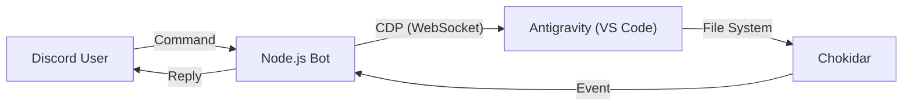

# Antigravity Discord Bot 仕様書

## 1. 概要

Antigravity Discord Bot は、Chrome DevTools Protocol（CDP）を使い、ローカルで動作する Antigravity（VS Code Fork）を Discord から遠隔操作するツールです。
Antigravity 自体には外部操作用の API がないため、CDP 経由で DOM 操作と JavaScript 実行を行います。

## 2. システム構成

### アーキテクチャ図

### 主要コンポーネント

- **CDP（Chrome DevTools Protocol）**：Antigravity の WebView（iframe）内の DOM にアクセスし、ボタン操作やテキスト取得を行います。
- **Chokidar**：ファイルシステムを監視し、Antigravity が作成または変更したファイルを検知して Discord に通知します。
- **Discord.js**：Discord API との通信を担当します。

## 3. 機能詳細

### 3.1 テキスト生成

ユーザーから受け取ったメッセージを、CDP 経由で Antigravity のチャット入力欄へ入力します。
入力欄は `textarea[class*="input"]` などのセレクターで探索します。
送信ボタンのクリックまたは `Enter` キーイベントの発火によって生成を開始します。

### 3.2 モデル切替（`/model`）

Antigravity の UI にあるモデル選択ドロップダウンを操作します。

DOM 操作は次の順序で行います。

1. `<button aria-expanded="false">` をクリックし、ドロップダウンを開きます。
2. ドロップダウン内のモデル名を取得します。
3. 指定されたモデル名の要素をクリックします。

対象要素は iframe 内にあるため、すべての iframe を走査して探索します。

### 3.3 モード切替（`/mode`）

Planning Mode と Fast Mode を切り替えます。

DOM 操作は次の順序で行います。

1. モード切替トグルをクリックします。
2. ダイアログ内の `Planning` または `Fast` をクリックします。

### 3.4 チャットタイトル取得（`/title`）

現在のチャットセッションのタイトルを取得します。
`p.text-ide-sidebar-title-color` クラスを持つ要素を探し、そのテキストを読み取ります。

### 3.5 ファイル監視

プロジェクトルート以下のファイル変更を監視します。
監視対象は環境変数 `WATCH_DIR` または起動時の対話設定で指定でき、未指定のまま Enter を押すと監視を無効にできます。

`node_modules`、`.git`、`.env`、ログファイルなどは監視対象から除外します。
新規作成（`add`）または変更（`change`）を検知すると、ファイルパスを Discord に通知します。
対象がテキストファイルの場合は、内容も通知に含めます。

## 4. 環境設定

### 必要な環境変数（`.env`）

- `DISCORD_BOT_TOKEN`：Discord Bot のトークン。
- `DISCORD_ALLOWED_USER_ID`：Bot の操作を許可する Discord ユーザー ID。
- `WATCH_DIR`：任意の監視対象ディレクトリ。
  未指定の場合は起動時に対話形式で指定でき、空欄のまま Enter を押すと監視機能を無効にします。

### 依存関係

- `discord.js`: ^14.x
- `chokidar`: ^3.x
- `ws`: ^8.x
- `dotenv`: ^16.x
